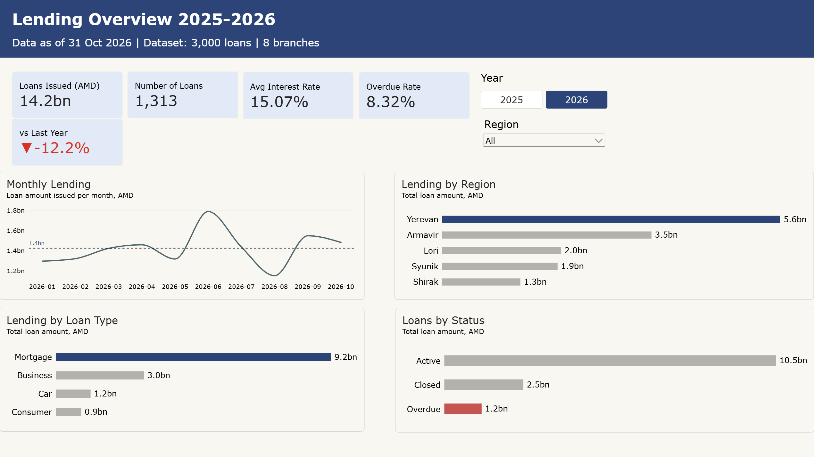
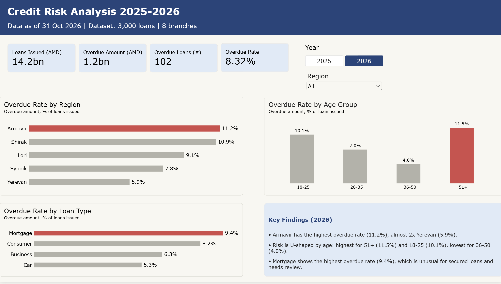
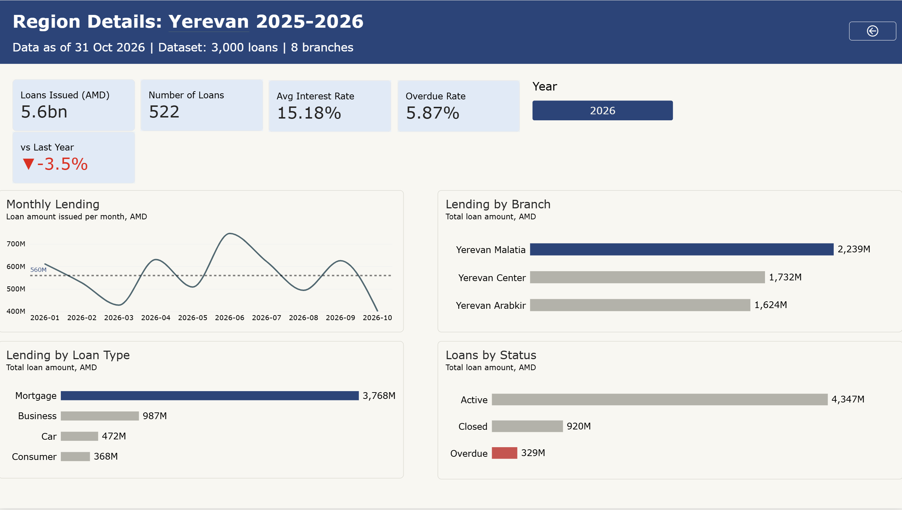
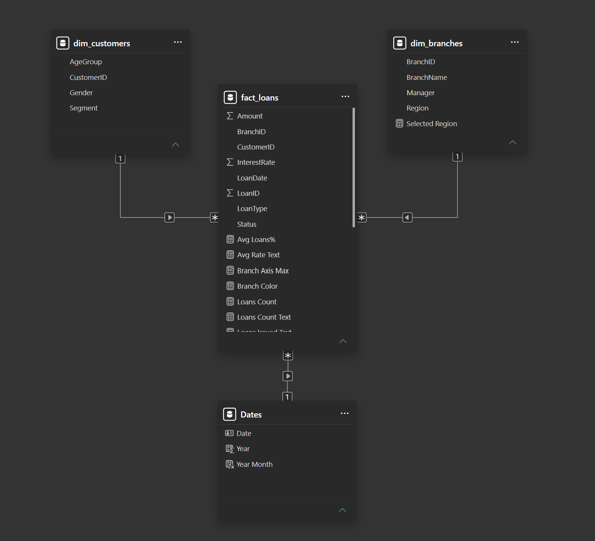

# Bank Lending Analysis: SQL Server & Power BI

End-to-end analysis of a bank's lending activity: from a SQL Server database to an interactive Power BI dashboard.

As an economist, I built this project to practise SQL and Power BI on banking data.

> **Note:** the data is **synthetic** (generated for learning purposes) and does not represent any real bank.

## Business questions
- How much does the bank lend, and how is lending changing compared with last year?
- Which regions, branches and loan types drive lending?
- Where is credit risk concentrated (by region, age group and loan type)?

## Tools
- **SQL Server (T-SQL):** JOIN, GROUP BY, CASE WHEN, aggregate functions, TOP
- **Power BI:** data model (star schema), DAX measures (YoY, weighted average, conditional formatting), drill-through, slicers

## Dataset
- 3,000 loans, 500 customers, 8 branches in 5 regions of Armenia
- Period: January 2025 - October 2026

## Dashboard

### 1. Lending Overview

### 2. Credit Risk Analysis

### 3. Region Details (drill-through)

### 4. Data Model

## Key findings (Jan - Oct 2026)
- **14.2bn AMD** issued in 1,313 loans, **12.2% less** than in the same period of 2025.
- **Yerevan** is the largest region (5.6bn AMD), and **mortgages** make up about two thirds of lending (9.2bn AMD).
- **Weighted average interest rate is 13.06%.**
- **Overdue rate is 8.32%** (1.2bn AMD).
- **Armavir** has the highest overdue rate (11.2%), almost 2x Yerevan (5.9%).
- Risk is **U-shaped by age**: highest for 51+ (11.5%) and 18-25 (10.1%), lowest for 36-50 (4.0%).
- **Mortgage** shows the highest overdue rate (9.4%), which is unusual for secured loans and needs review.

## Definitions and limitations
- **Loans issued** = original loan amounts (no outstanding balances in the data).
- **Overdue rate** = overdue loan amount as % of loans issued.
- **Average interest rate** is weighted by loan amount.
- SQL queries cover the full period; the dashboard can be filtered by year and region.

## Repository structure
- `sql/01_create_tables.sql` - creates the tables and generates the synthetic data
- `sql/02_analysis.sql` - business questions answered with SQL
- `powerbi/bank_loan_dashboard.pbix` - Power BI dashboard
- `images/` - dashboard screenshots

## Author
**Karlos Margaryan** - Economist transitioning into Data Analytics
[LinkedIn](https://www.linkedin.com/in/karlos-margaryan/)
